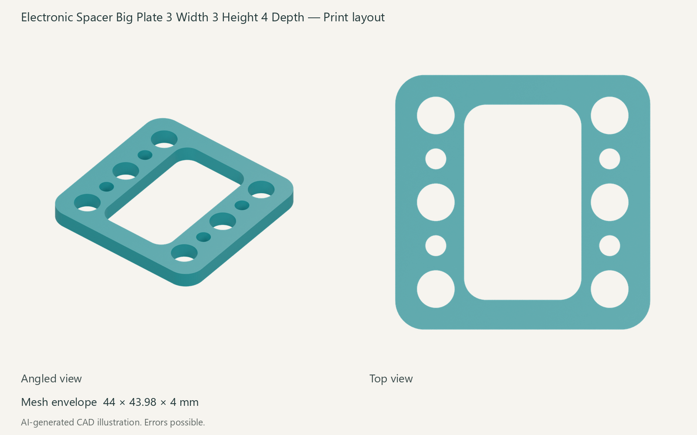

<!-- oobb-presentation:start -->
# OOBB electronic parts

AI-generated images and instructions. Errors possible.

## Summary

OOBB electronic spacers and mounting parts, organised by their actual component type and dimensions.

This is an entirely AI-generated coding project. The generated outputs are included and usually work, but the main purpose of publishing it is to give others a starting point for modifying the project with their own AI tools.

[Example part](parts/oobb_part_electronic_spacer_big_plate_3_width_3_height_4_depth/)

## Details

This catalogue contains **28 records**. [Browse OOBB navigation](navigation_oobb/oobb/part/electronic/).

Each part has one canonical folder, its full OOMP ID and complete metadata. Navigation links open folders; use GitHub’s file pane to browse the available files.

[Build and maintenance guide](CATALOGUE_BUILD.md)

## Parts

Select the spacer or mounting variant matching the required electronics layout. Electronic boards and mounting hardware are not supplied as printable parts.

## Assembly

Check the dimensions and mounting-hole arrangement against the actual board before printing and fitting the selected component.
<!-- oobb-presentation:end -->
