<!-- oobb-presentation:start -->
# OOBB electronic parts

3D-print keyed wire holders, spacers and barrel-jack mounts for the OOBB grid. The catalogue includes printable STLs, dimensioned CAD views and illustrated wiring guides for five single-row connectors and triple headers with two to ten rows.

Designed for the [OOBB version 5 building system](https://github.com/oomlout/oomlout_oobb_version_5) by [oomlout](https://github.com/oomlout).

This is an entirely AI-generated coding project. The source code is largely unreadable by humans, but usable generated files are included. It is published so others can use their own AI tools to understand, modify and regenerate the design.

AI-generated CAD images and instructions. Errors possible.

[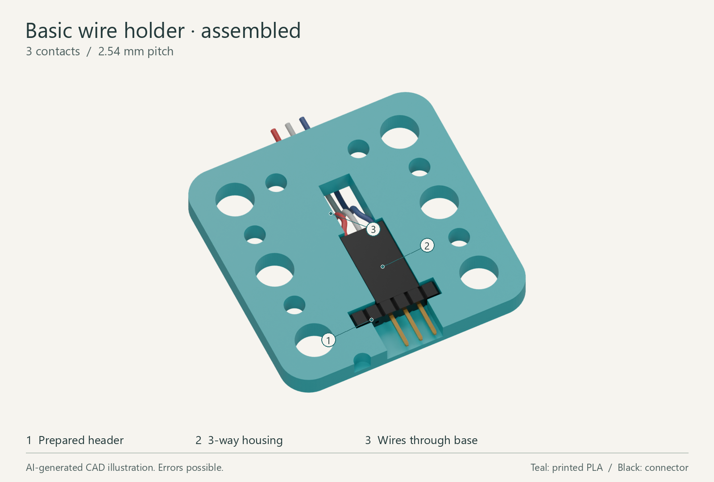](parts/oobb_part_electronic_wire_basic_plate_3_width_3_height_4_depth/README.md)

## Details

This catalogue contains **28 records**. [Browse OOBB navigation](navigation_oobb/oobb/part/electronic/).

[Build and maintenance guide](CATALOGUE_BUILD.md)

## Parts

[Spacer plates](navigation_oobb/oobb/part/electronic/spacer/) · [Barrel-jack mounts](navigation_oobb/oobb/part/electronic/wire/power/barrel_jack_2_1_mm/)

| Connector | Contacts | Part and hardware | Browser guide | Print guide |
| --- | ---: | --- | --- | --- |
| [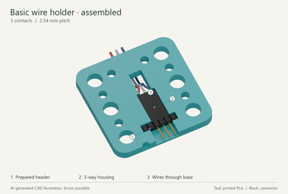](parts/oobb_part_electronic_wire_basic_plate_3_width_3_height_4_depth/README.md) | 3 | [Basic wire holder](parts/oobb_part_electronic_wire_basic_plate_3_width_3_height_4_depth/README.md) | [Browser guide](https://oomlout.github.io/oomlout_oobb_electronic_version_5/parts/oobb_part_electronic_wire_basic_plate_3_width_3_height_4_depth/assembly/assembly_instructions.html) | [PDF](https://oomlout.github.io/oomlout_oobb_electronic_version_5/parts/oobb_part_electronic_wire_basic_plate_3_width_3_height_4_depth/assembly/assembly_instructions.pdf) |
| [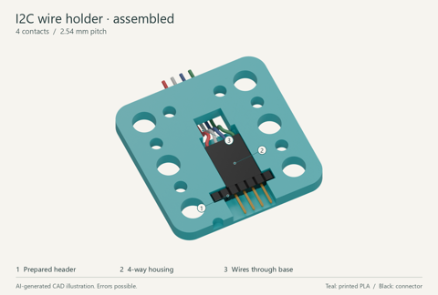](parts/oobb_part_electronic_wire_i2c_plate_3_width_3_height_4_depth/README.md) | 4 | [I²C wire holder](parts/oobb_part_electronic_wire_i2c_plate_3_width_3_height_4_depth/README.md) | [Browser guide](https://oomlout.github.io/oomlout_oobb_electronic_version_5/parts/oobb_part_electronic_wire_i2c_plate_3_width_3_height_4_depth/assembly/assembly_instructions.html) | [PDF](https://oomlout.github.io/oomlout_oobb_electronic_version_5/parts/oobb_part_electronic_wire_i2c_plate_3_width_3_height_4_depth/assembly/assembly_instructions.pdf) |
|  | 2 | [Motor wire holder](parts/oobb_part_electronic_wire_motor_plate_3_width_3_height_4_depth/README.md) | [Browser guide](https://oomlout.github.io/oomlout_oobb_electronic_version_5/parts/oobb_part_electronic_wire_motor_plate_3_width_3_height_4_depth/assembly/assembly_instructions.html) | [PDF](https://oomlout.github.io/oomlout_oobb_electronic_version_5/parts/oobb_part_electronic_wire_motor_plate_3_width_3_height_4_depth/assembly/assembly_instructions.pdf) |
| [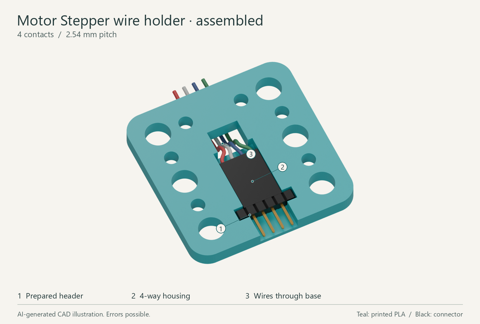](parts/oobb_part_electronic_wire_motor_stepper_plate_3_width_3_height_4_depth/README.md) | 4 | [Stepper motor wire holder](parts/oobb_part_electronic_wire_motor_stepper_plate_3_width_3_height_4_depth/README.md) | [Browser guide](https://oomlout.github.io/oomlout_oobb_electronic_version_5/parts/oobb_part_electronic_wire_motor_stepper_plate_3_width_3_height_4_depth/assembly/assembly_instructions.html) | [PDF](https://oomlout.github.io/oomlout_oobb_electronic_version_5/parts/oobb_part_electronic_wire_motor_stepper_plate_3_width_3_height_4_depth/assembly/assembly_instructions.pdf) |
| [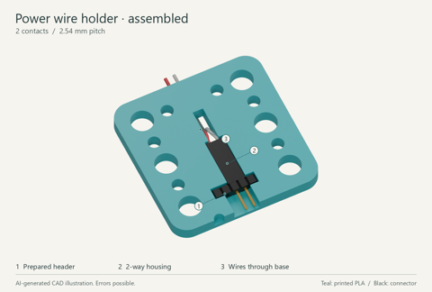](parts/oobb_part_electronic_wire_power_plate_3_width_3_height_4_depth/README.md) | 2 | [Power wire holder](parts/oobb_part_electronic_wire_power_plate_3_width_3_height_4_depth/README.md) | [Browser guide](https://oomlout.github.io/oomlout_oobb_electronic_version_5/parts/oobb_part_electronic_wire_power_plate_3_width_3_height_4_depth/assembly/assembly_instructions.html) | [PDF](https://oomlout.github.io/oomlout_oobb_electronic_version_5/parts/oobb_part_electronic_wire_power_plate_3_width_3_height_4_depth/assembly/assembly_instructions.pdf) |
| [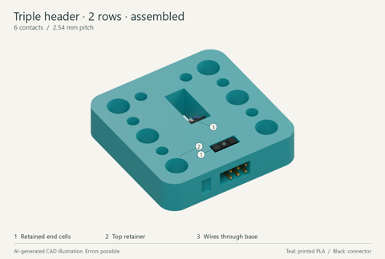](parts/oobb_part_electronic_wire_basic_plate_3_width_3_height_7_62_depth_triple_pin_header_2_multiple/README.md) | 6 | [Triple header · 2 rows](parts/oobb_part_electronic_wire_basic_plate_3_width_3_height_7_62_depth_triple_pin_header_2_multiple/README.md) | [Browser guide](https://oomlout.github.io/oomlout_oobb_electronic_version_5/parts/oobb_part_electronic_wire_basic_plate_3_width_3_height_7_62_depth_triple_pin_header_2_multiple/assembly/assembly_instructions.html) | [PDF](https://oomlout.github.io/oomlout_oobb_electronic_version_5/parts/oobb_part_electronic_wire_basic_plate_3_width_3_height_7_62_depth_triple_pin_header_2_multiple/assembly/assembly_instructions.pdf) |
| [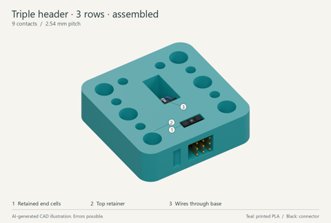](parts/oobb_part_electronic_wire_basic_plate_3_width_3_height_10_16_depth_triple_pin_header_3_multiple/README.md) | 9 | [Triple header · 3 rows](parts/oobb_part_electronic_wire_basic_plate_3_width_3_height_10_16_depth_triple_pin_header_3_multiple/README.md) | [Browser guide](https://oomlout.github.io/oomlout_oobb_electronic_version_5/parts/oobb_part_electronic_wire_basic_plate_3_width_3_height_10_16_depth_triple_pin_header_3_multiple/assembly/assembly_instructions.html) | [PDF](https://oomlout.github.io/oomlout_oobb_electronic_version_5/parts/oobb_part_electronic_wire_basic_plate_3_width_3_height_10_16_depth_triple_pin_header_3_multiple/assembly/assembly_instructions.pdf) |
| [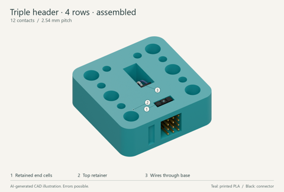](parts/oobb_part_electronic_wire_basic_plate_3_width_3_height_12_7_depth_triple_pin_header_4_multiple/README.md) | 12 | [Triple header · 4 rows](parts/oobb_part_electronic_wire_basic_plate_3_width_3_height_12_7_depth_triple_pin_header_4_multiple/README.md) | [Browser guide](https://oomlout.github.io/oomlout_oobb_electronic_version_5/parts/oobb_part_electronic_wire_basic_plate_3_width_3_height_12_7_depth_triple_pin_header_4_multiple/assembly/assembly_instructions.html) | [PDF](https://oomlout.github.io/oomlout_oobb_electronic_version_5/parts/oobb_part_electronic_wire_basic_plate_3_width_3_height_12_7_depth_triple_pin_header_4_multiple/assembly/assembly_instructions.pdf) |
| [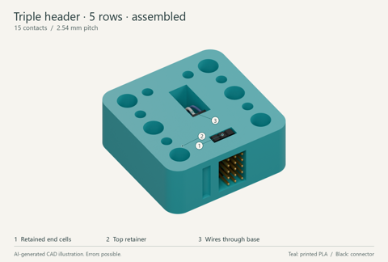](parts/oobb_part_electronic_wire_basic_plate_3_width_3_height_15_24_depth_triple_pin_header_5_multiple/README.md) | 15 | [Triple header · 5 rows](parts/oobb_part_electronic_wire_basic_plate_3_width_3_height_15_24_depth_triple_pin_header_5_multiple/README.md) | [Browser guide](https://oomlout.github.io/oomlout_oobb_electronic_version_5/parts/oobb_part_electronic_wire_basic_plate_3_width_3_height_15_24_depth_triple_pin_header_5_multiple/assembly/assembly_instructions.html) | [PDF](https://oomlout.github.io/oomlout_oobb_electronic_version_5/parts/oobb_part_electronic_wire_basic_plate_3_width_3_height_15_24_depth_triple_pin_header_5_multiple/assembly/assembly_instructions.pdf) |
| [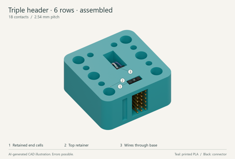](parts/oobb_part_electronic_wire_basic_plate_3_width_3_height_17_78_depth_triple_pin_header_6_multiple/README.md) | 18 | [Triple header · 6 rows](parts/oobb_part_electronic_wire_basic_plate_3_width_3_height_17_78_depth_triple_pin_header_6_multiple/README.md) | [Browser guide](https://oomlout.github.io/oomlout_oobb_electronic_version_5/parts/oobb_part_electronic_wire_basic_plate_3_width_3_height_17_78_depth_triple_pin_header_6_multiple/assembly/assembly_instructions.html) | [PDF](https://oomlout.github.io/oomlout_oobb_electronic_version_5/parts/oobb_part_electronic_wire_basic_plate_3_width_3_height_17_78_depth_triple_pin_header_6_multiple/assembly/assembly_instructions.pdf) |
|  | 21 | [Triple header · 7 rows](parts/oobb_part_electronic_wire_basic_plate_3_width_3_height_20_32_depth_triple_pin_header_7_multiple/README.md) | [Browser guide](https://oomlout.github.io/oomlout_oobb_electronic_version_5/parts/oobb_part_electronic_wire_basic_plate_3_width_3_height_20_32_depth_triple_pin_header_7_multiple/assembly/assembly_instructions.html) | [PDF](https://oomlout.github.io/oomlout_oobb_electronic_version_5/parts/oobb_part_electronic_wire_basic_plate_3_width_3_height_20_32_depth_triple_pin_header_7_multiple/assembly/assembly_instructions.pdf) |
| [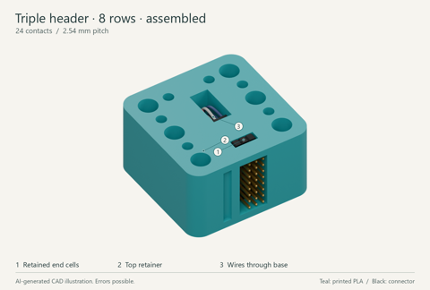](parts/oobb_part_electronic_wire_basic_plate_3_width_3_height_22_86_depth_triple_pin_header_8_multiple/README.md) | 24 | [Triple header · 8 rows](parts/oobb_part_electronic_wire_basic_plate_3_width_3_height_22_86_depth_triple_pin_header_8_multiple/README.md) | [Browser guide](https://oomlout.github.io/oomlout_oobb_electronic_version_5/parts/oobb_part_electronic_wire_basic_plate_3_width_3_height_22_86_depth_triple_pin_header_8_multiple/assembly/assembly_instructions.html) | [PDF](https://oomlout.github.io/oomlout_oobb_electronic_version_5/parts/oobb_part_electronic_wire_basic_plate_3_width_3_height_22_86_depth_triple_pin_header_8_multiple/assembly/assembly_instructions.pdf) |
| [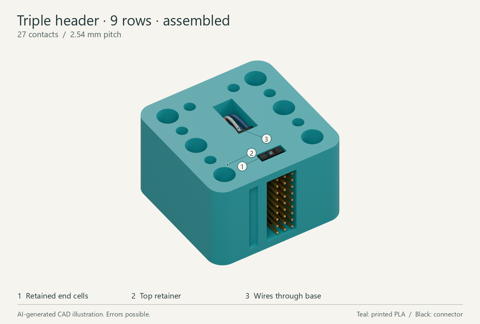](parts/oobb_part_electronic_wire_basic_plate_3_width_3_height_25_4_depth_triple_pin_header_9_multiple/README.md) | 27 | [Triple header · 9 rows](parts/oobb_part_electronic_wire_basic_plate_3_width_3_height_25_4_depth_triple_pin_header_9_multiple/README.md) | [Browser guide](https://oomlout.github.io/oomlout_oobb_electronic_version_5/parts/oobb_part_electronic_wire_basic_plate_3_width_3_height_25_4_depth_triple_pin_header_9_multiple/assembly/assembly_instructions.html) | [PDF](https://oomlout.github.io/oomlout_oobb_electronic_version_5/parts/oobb_part_electronic_wire_basic_plate_3_width_3_height_25_4_depth_triple_pin_header_9_multiple/assembly/assembly_instructions.pdf) |
| [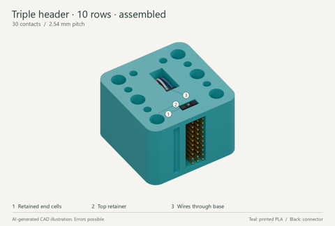](parts/oobb_part_electronic_wire_basic_plate_3_width_3_height_27_94_depth_triple_pin_header_10_multiple/README.md) | 30 | [Triple header · 10 rows](parts/oobb_part_electronic_wire_basic_plate_3_width_3_height_27_94_depth_triple_pin_header_10_multiple/README.md) | [Browser guide](https://oomlout.github.io/oomlout_oobb_electronic_version_5/parts/oobb_part_electronic_wire_basic_plate_3_width_3_height_27_94_depth_triple_pin_header_10_multiple/assembly/assembly_instructions.html) | [PDF](https://oomlout.github.io/oomlout_oobb_electronic_version_5/parts/oobb_part_electronic_wire_basic_plate_3_width_3_height_27_94_depth_triple_pin_header_10_multiple/assembly/assembly_instructions.pdf) |

## Assembly

Use 2.54 mm pitch long header stock with 6.25 mm of pin exposed on each side. The empty plastic cells locate the header in the printed plate. Choose the guide that matches your print. The illustrated fits have not been physically tested.

Basic wire holder

[Parts and hardware](parts/oobb_part_electronic_wire_basic_plate_3_width_3_height_4_depth/README.md#parts)

1. Cut one 6-position section of header_long (6.25 mm exposed at both ends). Count from the key side (negative X in the model) and push out pins 1, 2, 6; keep the full plastic strip.

[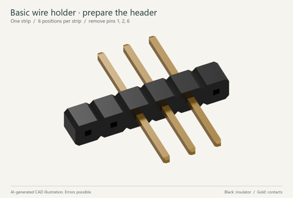](parts/oobb_part_electronic_wire_basic_plate_3_width_3_height_4_depth/basic_wire_keyed.png)

2. Pass 3 wires up through the rear opening before crimping. Crimp one socket per wire and insert the sockets into the backs of the housings until latched.

[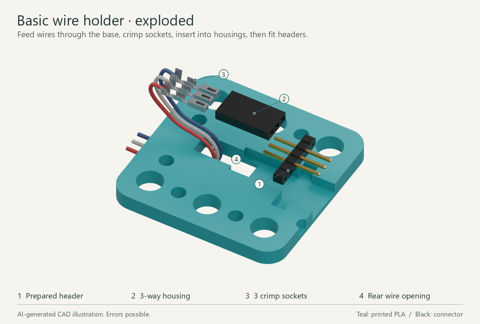](parts/oobb_part_electronic_wire_basic_plate_3_width_3_height_4_depth/basic_wire_exploded.png)

3. Mate the housing with the rear 6.25 mm pin ends, then lower the header and housing into their seats. The equal front ends face the front opening.

4. Check that the wires move freely through the rear opening and the contacts remain recessed inside the front edge.

The stock and prepared header rows describe the same item before and after modification. Use 15 mm overall header_long stock (6.25 mm exposed on each side of a 2.5 mm insulator); LCSC C343639 is a 40-position strip cut to the required lengths. Wire colours identify conductors, not a pinout. Housing and uncrimped socket geometry use nominal Harwin M20 references; wire bends are illustrative.

I²C wire holder

[Parts and hardware](parts/oobb_part_electronic_wire_i2c_plate_3_width_3_height_4_depth/README.md#parts)

1. Cut one 7-position section of header_long (6.25 mm exposed at both ends). Count from the key side (negative X in the model) and push out pins 1, 2, 7; keep the full plastic strip.

[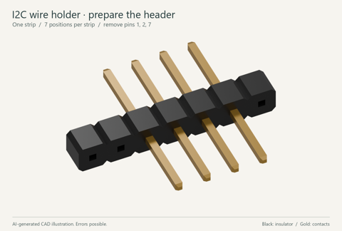](parts/oobb_part_electronic_wire_i2c_plate_3_width_3_height_4_depth/basic_wire_keyed.png)

2. Pass 4 wires up through the rear opening before crimping. Crimp one socket per wire and insert the sockets into the backs of the housings until latched.

[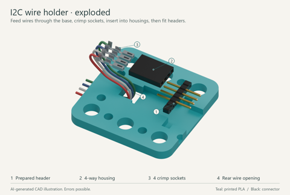](parts/oobb_part_electronic_wire_i2c_plate_3_width_3_height_4_depth/basic_wire_exploded.png)

3. Mate the housing with the rear 6.25 mm pin ends, then lower the header and housing into their seats. The equal front ends face the front opening.

[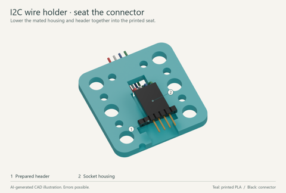](parts/oobb_part_electronic_wire_i2c_plate_3_width_3_height_4_depth/basic_wire_seating.png)

4. Check that the wires move freely through the rear opening and the contacts remain recessed inside the front edge.

The stock and prepared header rows describe the same item before and after modification. Use 15 mm overall header_long stock (6.25 mm exposed on each side of a 2.5 mm insulator); LCSC C343639 is a 40-position strip cut to the required lengths. Wire colours identify conductors, not a pinout. Housing and uncrimped socket geometry use nominal Harwin M20 references; wire bends are illustrative.

Motor wire holder

[Parts and hardware](parts/oobb_part_electronic_wire_motor_plate_3_width_3_height_4_depth/README.md#parts)

1. Cut one 4-position header_long section, with equal 6.25 mm ends, and push out the two end pins (1, 4); keep the full plastic strip.

[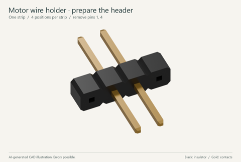](parts/oobb_part_electronic_wire_motor_plate_3_width_3_height_4_depth/basic_wire_keyed.png)

2. Pass 2 wires up through the rear opening before crimping. Crimp one socket per wire and insert the sockets into the backs of the housings until latched.

[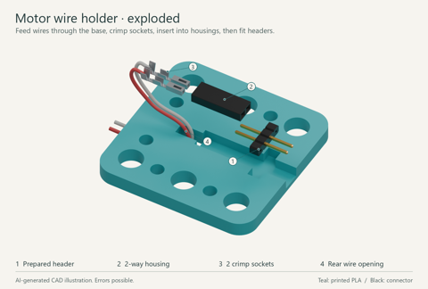](parts/oobb_part_electronic_wire_motor_plate_3_width_3_height_4_depth/basic_wire_exploded.png)

3. Mate the housing with the rear 6.25 mm pin ends, then lower the header and housing into their seats. The equal front ends face the front opening.

[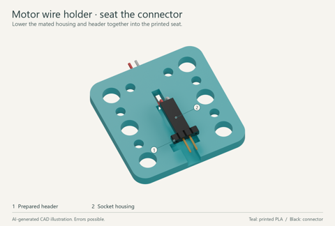](parts/oobb_part_electronic_wire_motor_plate_3_width_3_height_4_depth/basic_wire_seating.png)

4. Check that the wires move freely through the rear opening and the contacts remain recessed inside the front edge.

The stock and prepared header rows describe the same item before and after modification. Use 15 mm overall header_long stock (6.25 mm exposed on each side of a 2.5 mm insulator); LCSC C343639 is a 40-position strip cut to the required lengths. Wire colours identify conductors, not a pinout. Housing and uncrimped socket geometry use nominal Harwin M20 references; wire bends are illustrative.

Stepper motor wire holder

[Parts and hardware](parts/oobb_part_electronic_wire_motor_stepper_plate_3_width_3_height_4_depth/README.md#parts)

1. Cut one 6-position header_long section, with equal 6.25 mm ends, and push out the two end pins (1, 6); keep the full plastic strip.

[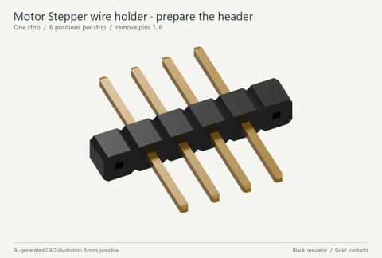](parts/oobb_part_electronic_wire_motor_stepper_plate_3_width_3_height_4_depth/basic_wire_keyed.png)

2. Pass 4 wires up through the rear opening before crimping. Crimp one socket per wire and insert the sockets into the backs of the housings until latched.

[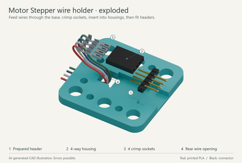](parts/oobb_part_electronic_wire_motor_stepper_plate_3_width_3_height_4_depth/basic_wire_exploded.png)

3. Mate the housing with the rear 6.25 mm pin ends, then lower the header and housing into their seats. The equal front ends face the front opening.

[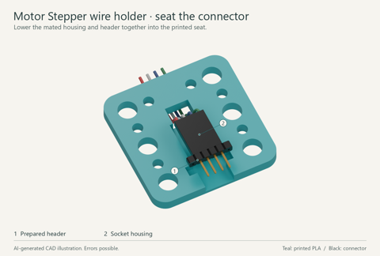](parts/oobb_part_electronic_wire_motor_stepper_plate_3_width_3_height_4_depth/basic_wire_seating.png)

4. Check that the wires move freely through the rear opening and the contacts remain recessed inside the front edge.

The stock and prepared header rows describe the same item before and after modification. Use 15 mm overall header_long stock (6.25 mm exposed on each side of a 2.5 mm insulator); LCSC C343639 is a 40-position strip cut to the required lengths. Wire colours identify conductors, not a pinout. Housing and uncrimped socket geometry use nominal Harwin M20 references; wire bends are illustrative.

Power wire holder

[Parts and hardware](parts/oobb_part_electronic_wire_power_plate_3_width_3_height_4_depth/README.md#parts)

1. Cut one 5-position section of header_long (6.25 mm exposed at both ends). Count from the key side (negative X in the model) and push out pins 1, 2, 5; keep the full plastic strip.

[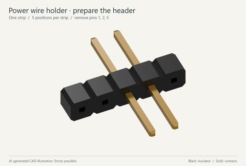](parts/oobb_part_electronic_wire_power_plate_3_width_3_height_4_depth/basic_wire_keyed.png)

2. Pass 2 wires up through the rear opening before crimping. Crimp one socket per wire and insert the sockets into the backs of the housings until latched.

3. Mate the housing with the rear 6.25 mm pin ends, then lower the header and housing into their seats. The equal front ends face the front opening.

[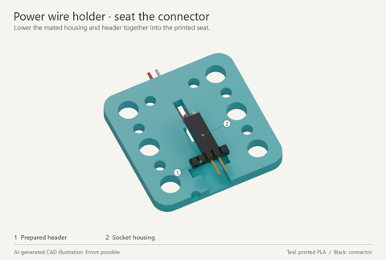](parts/oobb_part_electronic_wire_power_plate_3_width_3_height_4_depth/basic_wire_seating.png)

4. Check that the wires move freely through the rear opening and the contacts remain recessed inside the front edge.

The stock and prepared header rows describe the same item before and after modification. Use 15 mm overall header_long stock (6.25 mm exposed on each side of a 2.5 mm insulator); LCSC C343639 is a 40-position strip cut to the required lengths. Wire colours identify conductors, not a pinout. Housing and uncrimped socket geometry use nominal Harwin M20 references; wire bends are illustrative.

Triple header · 2 rows

[Parts and hardware](parts/oobb_part_electronic_wire_basic_plate_3_width_3_height_7_62_depth_triple_pin_header_2_multiple/README.md#parts)

1. Cut three 4-position sections of header_long (6.25 mm exposed at both ends). Push out pins 1, 4 from each strip; keep both end cells intact. Stand the strips vertically, counting from the bottom.

[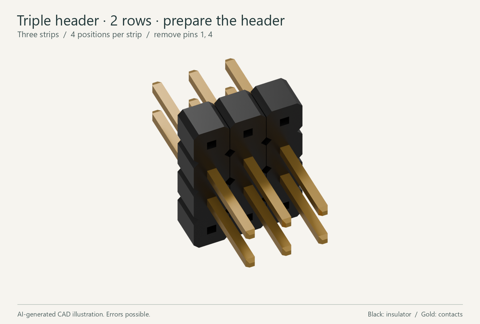](parts/oobb_part_electronic_wire_basic_plate_3_width_3_height_7_62_depth_triple_pin_header_2_multiple/basic_wire_keyed.png)

2. Pass 6 wires up through the rear opening before crimping. Crimp one socket per wire and insert the sockets into the backs of the housings until latched.

[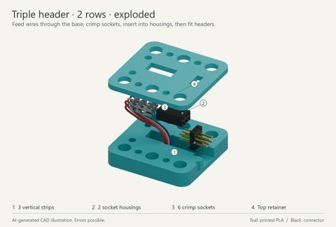](parts/oobb_part_electronic_wire_basic_plate_3_width_3_height_7_62_depth_triple_pin_header_2_multiple/basic_wire_exploded.png)

3. Place the three vertical strips into the bottom beam window, with one set of pin ends facing the keyed front opening. Mate one three-way housing with each active row.

[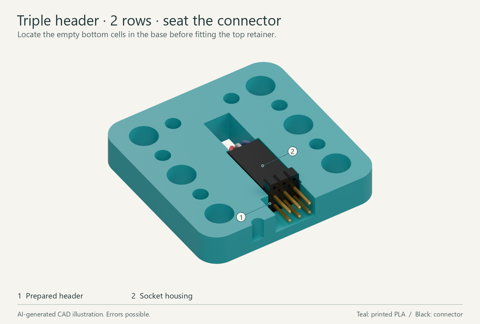](parts/oobb_part_electronic_wire_basic_plate_3_width_3_height_7_62_depth_triple_pin_header_2_multiple/basic_wire_seating.png)

4. Fit the included top retainer over the three empty top cells. It is printed beside the base in the same part file. Keep the rear wire opening clear.

The stock and prepared header rows describe the same item before and after modification. Use 15 mm overall header_long stock (6.25 mm exposed on each side of a 2.5 mm insulator); LCSC C343639 is a 40-position strip cut to the required lengths. Wire colours identify conductors, not a pinout. Housing and uncrimped socket geometry use nominal Harwin M20 references; wire bends are illustrative.

Triple header · 3 rows

[Parts and hardware](parts/oobb_part_electronic_wire_basic_plate_3_width_3_height_10_16_depth_triple_pin_header_3_multiple/README.md#parts)

1. Cut three 5-position sections of header_long (6.25 mm exposed at both ends). Push out pins 1, 5 from each strip; keep both end cells intact. Stand the strips vertically, counting from the bottom.

[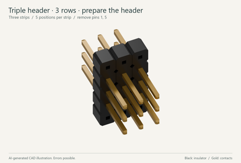](parts/oobb_part_electronic_wire_basic_plate_3_width_3_height_10_16_depth_triple_pin_header_3_multiple/basic_wire_keyed.png)

2. Pass 9 wires up through the rear opening before crimping. Crimp one socket per wire and insert the sockets into the backs of the housings until latched.

[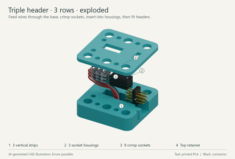](parts/oobb_part_electronic_wire_basic_plate_3_width_3_height_10_16_depth_triple_pin_header_3_multiple/basic_wire_exploded.png)

3. Place the three vertical strips into the bottom beam window, with one set of pin ends facing the keyed front opening. Mate one three-way housing with each active row.

[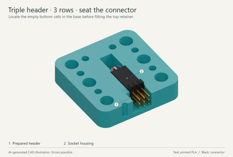](parts/oobb_part_electronic_wire_basic_plate_3_width_3_height_10_16_depth_triple_pin_header_3_multiple/basic_wire_seating.png)

4. Fit the included top retainer over the three empty top cells. It is printed beside the base in the same part file. Keep the rear wire opening clear.

The stock and prepared header rows describe the same item before and after modification. Use 15 mm overall header_long stock (6.25 mm exposed on each side of a 2.5 mm insulator); LCSC C343639 is a 40-position strip cut to the required lengths. Wire colours identify conductors, not a pinout. Housing and uncrimped socket geometry use nominal Harwin M20 references; wire bends are illustrative.

Triple header · 4 rows

[Parts and hardware](parts/oobb_part_electronic_wire_basic_plate_3_width_3_height_12_7_depth_triple_pin_header_4_multiple/README.md#parts)

1. Cut three 6-position sections of header_long (6.25 mm exposed at both ends). Push out pins 1, 6 from each strip; keep both end cells intact. Stand the strips vertically, counting from the bottom.

[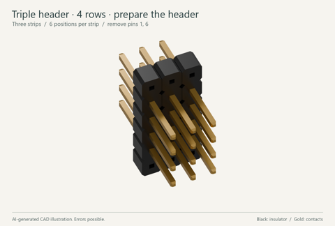](parts/oobb_part_electronic_wire_basic_plate_3_width_3_height_12_7_depth_triple_pin_header_4_multiple/basic_wire_keyed.png)

2. Pass 12 wires up through the rear opening before crimping. Crimp one socket per wire and insert the sockets into the backs of the housings until latched.

[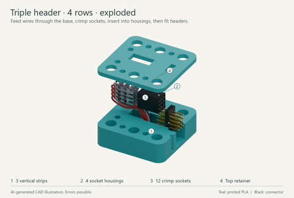](parts/oobb_part_electronic_wire_basic_plate_3_width_3_height_12_7_depth_triple_pin_header_4_multiple/basic_wire_exploded.png)

3. Place the three vertical strips into the bottom beam window, with one set of pin ends facing the keyed front opening. Mate one three-way housing with each active row.

[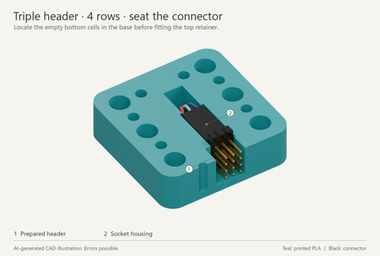](parts/oobb_part_electronic_wire_basic_plate_3_width_3_height_12_7_depth_triple_pin_header_4_multiple/basic_wire_seating.png)

4. Fit the included top retainer over the three empty top cells. It is printed beside the base in the same part file. Keep the rear wire opening clear.

The stock and prepared header rows describe the same item before and after modification. Use 15 mm overall header_long stock (6.25 mm exposed on each side of a 2.5 mm insulator); LCSC C343639 is a 40-position strip cut to the required lengths. Wire colours identify conductors, not a pinout. Housing and uncrimped socket geometry use nominal Harwin M20 references; wire bends are illustrative.

Triple header · 5 rows

[Parts and hardware](parts/oobb_part_electronic_wire_basic_plate_3_width_3_height_15_24_depth_triple_pin_header_5_multiple/README.md#parts)

1. Cut three 7-position sections of header_long (6.25 mm exposed at both ends). Push out pins 1, 7 from each strip; keep both end cells intact. Stand the strips vertically, counting from the bottom.

[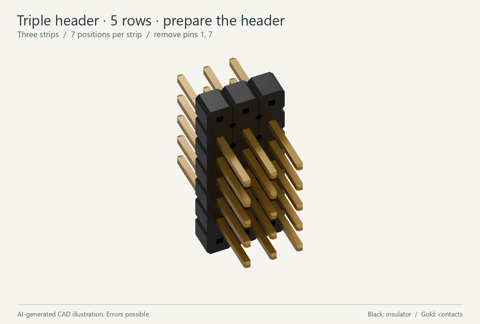](parts/oobb_part_electronic_wire_basic_plate_3_width_3_height_15_24_depth_triple_pin_header_5_multiple/basic_wire_keyed.png)

2. Pass 15 wires up through the rear opening before crimping. Crimp one socket per wire and insert the sockets into the backs of the housings until latched.

[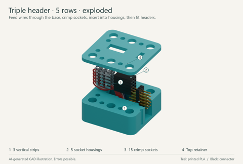](parts/oobb_part_electronic_wire_basic_plate_3_width_3_height_15_24_depth_triple_pin_header_5_multiple/basic_wire_exploded.png)

3. Place the three vertical strips into the bottom beam window, with one set of pin ends facing the keyed front opening. Mate one three-way housing with each active row.

[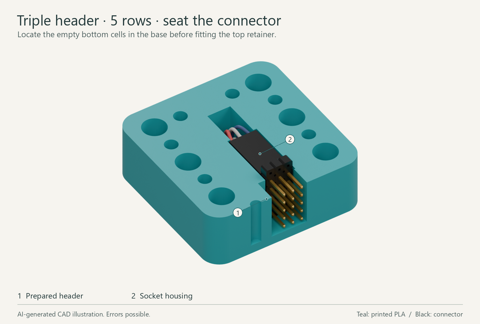](parts/oobb_part_electronic_wire_basic_plate_3_width_3_height_15_24_depth_triple_pin_header_5_multiple/basic_wire_seating.png)

4. Fit the included top retainer over the three empty top cells. It is printed beside the base in the same part file. Keep the rear wire opening clear.

The stock and prepared header rows describe the same item before and after modification. Use 15 mm overall header_long stock (6.25 mm exposed on each side of a 2.5 mm insulator); LCSC C343639 is a 40-position strip cut to the required lengths. Wire colours identify conductors, not a pinout. Housing and uncrimped socket geometry use nominal Harwin M20 references; wire bends are illustrative.

Triple header · 6 rows

[Parts and hardware](parts/oobb_part_electronic_wire_basic_plate_3_width_3_height_17_78_depth_triple_pin_header_6_multiple/README.md#parts)

1. Cut three 8-position sections of header_long (6.25 mm exposed at both ends). Push out pins 1, 8 from each strip; keep both end cells intact. Stand the strips vertically, counting from the bottom.

[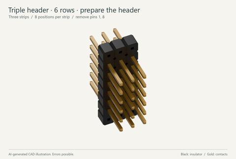](parts/oobb_part_electronic_wire_basic_plate_3_width_3_height_17_78_depth_triple_pin_header_6_multiple/basic_wire_keyed.png)

2. Pass 18 wires up through the rear opening before crimping. Crimp one socket per wire and insert the sockets into the backs of the housings until latched.

[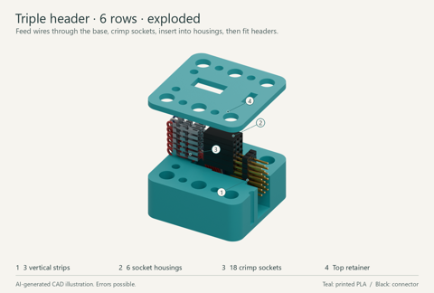](parts/oobb_part_electronic_wire_basic_plate_3_width_3_height_17_78_depth_triple_pin_header_6_multiple/basic_wire_exploded.png)

3. Place the three vertical strips into the bottom beam window, with one set of pin ends facing the keyed front opening. Mate one three-way housing with each active row.

4. Fit the included top retainer over the three empty top cells. It is printed beside the base in the same part file. Keep the rear wire opening clear.

The stock and prepared header rows describe the same item before and after modification. Use 15 mm overall header_long stock (6.25 mm exposed on each side of a 2.5 mm insulator); LCSC C343639 is a 40-position strip cut to the required lengths. Wire colours identify conductors, not a pinout. Housing and uncrimped socket geometry use nominal Harwin M20 references; wire bends are illustrative.

Triple header · 7 rows

[Parts and hardware](parts/oobb_part_electronic_wire_basic_plate_3_width_3_height_20_32_depth_triple_pin_header_7_multiple/README.md#parts)

1. Cut three 9-position sections of header_long (6.25 mm exposed at both ends). Push out pins 1, 9 from each strip; keep both end cells intact. Stand the strips vertically, counting from the bottom.

[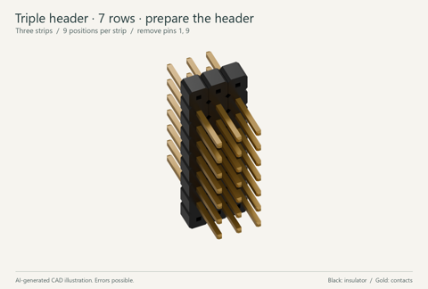](parts/oobb_part_electronic_wire_basic_plate_3_width_3_height_20_32_depth_triple_pin_header_7_multiple/basic_wire_keyed.png)

2. Pass 21 wires up through the rear opening before crimping. Crimp one socket per wire and insert the sockets into the backs of the housings until latched.

[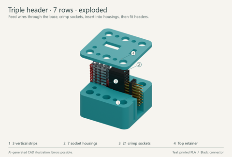](parts/oobb_part_electronic_wire_basic_plate_3_width_3_height_20_32_depth_triple_pin_header_7_multiple/basic_wire_exploded.png)

3. Place the three vertical strips into the bottom beam window, with one set of pin ends facing the keyed front opening. Mate one three-way housing with each active row.

[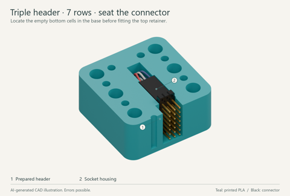](parts/oobb_part_electronic_wire_basic_plate_3_width_3_height_20_32_depth_triple_pin_header_7_multiple/basic_wire_seating.png)

4. Fit the included top retainer over the three empty top cells. It is printed beside the base in the same part file. Keep the rear wire opening clear.

The stock and prepared header rows describe the same item before and after modification. Use 15 mm overall header_long stock (6.25 mm exposed on each side of a 2.5 mm insulator); LCSC C343639 is a 40-position strip cut to the required lengths. Wire colours identify conductors, not a pinout. Housing and uncrimped socket geometry use nominal Harwin M20 references; wire bends are illustrative.

Triple header · 8 rows

[Parts and hardware](parts/oobb_part_electronic_wire_basic_plate_3_width_3_height_22_86_depth_triple_pin_header_8_multiple/README.md#parts)

1. Cut three 10-position sections of header_long (6.25 mm exposed at both ends). Push out pins 1, 10 from each strip; keep both end cells intact. Stand the strips vertically, counting from the bottom.

2. Pass 24 wires up through the rear opening before crimping. Crimp one socket per wire and insert the sockets into the backs of the housings until latched.

3. Place the three vertical strips into the bottom beam window, with one set of pin ends facing the keyed front opening. Mate one three-way housing with each active row.

4. Fit the included top retainer over the three empty top cells. It is printed beside the base in the same part file. Keep the rear wire opening clear.

The stock and prepared header rows describe the same item before and after modification. Use 15 mm overall header_long stock (6.25 mm exposed on each side of a 2.5 mm insulator); LCSC C343639 is a 40-position strip cut to the required lengths. Wire colours identify conductors, not a pinout. Housing and uncrimped socket geometry use nominal Harwin M20 references; wire bends are illustrative.

Triple header · 9 rows

[Parts and hardware](parts/oobb_part_electronic_wire_basic_plate_3_width_3_height_25_4_depth_triple_pin_header_9_multiple/README.md#parts)

1. Cut three 11-position sections of header_long (6.25 mm exposed at both ends). Push out pins 1, 11 from each strip; keep both end cells intact. Stand the strips vertically, counting from the bottom.

[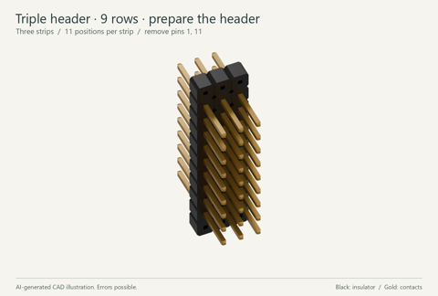](parts/oobb_part_electronic_wire_basic_plate_3_width_3_height_25_4_depth_triple_pin_header_9_multiple/basic_wire_keyed.png)

2. Pass 27 wires up through the rear opening before crimping. Crimp one socket per wire and insert the sockets into the backs of the housings until latched.

[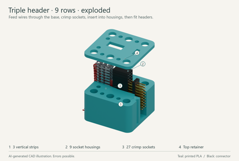](parts/oobb_part_electronic_wire_basic_plate_3_width_3_height_25_4_depth_triple_pin_header_9_multiple/basic_wire_exploded.png)

3. Place the three vertical strips into the bottom beam window, with one set of pin ends facing the keyed front opening. Mate one three-way housing with each active row.

4. Fit the included top retainer over the three empty top cells. It is printed beside the base in the same part file. Keep the rear wire opening clear.

The stock and prepared header rows describe the same item before and after modification. Use 15 mm overall header_long stock (6.25 mm exposed on each side of a 2.5 mm insulator); LCSC C343639 is a 40-position strip cut to the required lengths. Wire colours identify conductors, not a pinout. Housing and uncrimped socket geometry use nominal Harwin M20 references; wire bends are illustrative.

Triple header · 10 rows

[Parts and hardware](parts/oobb_part_electronic_wire_basic_plate_3_width_3_height_27_94_depth_triple_pin_header_10_multiple/README.md#parts)

1. Cut three 12-position sections of header_long (6.25 mm exposed at both ends). Push out pins 1, 12 from each strip; keep both end cells intact. Stand the strips vertically, counting from the bottom.

[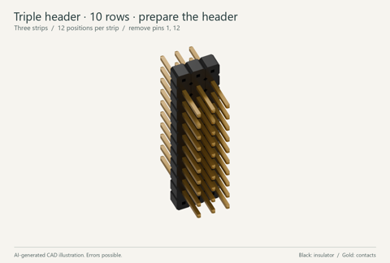](parts/oobb_part_electronic_wire_basic_plate_3_width_3_height_27_94_depth_triple_pin_header_10_multiple/basic_wire_keyed.png)

2. Pass 30 wires up through the rear opening before crimping. Crimp one socket per wire and insert the sockets into the backs of the housings until latched.

[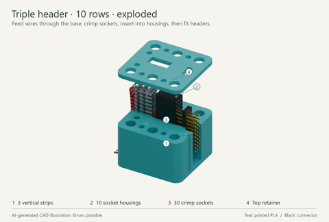](parts/oobb_part_electronic_wire_basic_plate_3_width_3_height_27_94_depth_triple_pin_header_10_multiple/basic_wire_exploded.png)

3. Place the three vertical strips into the bottom beam window, with one set of pin ends facing the keyed front opening. Mate one three-way housing with each active row.

[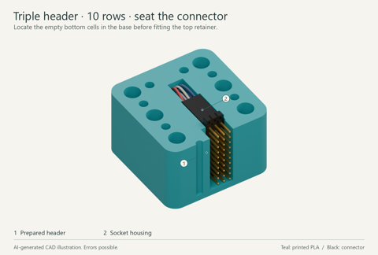](parts/oobb_part_electronic_wire_basic_plate_3_width_3_height_27_94_depth_triple_pin_header_10_multiple/basic_wire_seating.png)

4. Fit the included top retainer over the three empty top cells. It is printed beside the base in the same part file. Keep the rear wire opening clear.

The stock and prepared header rows describe the same item before and after modification. Use 15 mm overall header_long stock (6.25 mm exposed on each side of a 2.5 mm insulator); LCSC C343639 is a 40-position strip cut to the required lengths. Wire colours identify conductors, not a pinout. Housing and uncrimped socket geometry use nominal Harwin M20 references; wire bends are illustrative.

<!-- oobb-presentation:end -->
