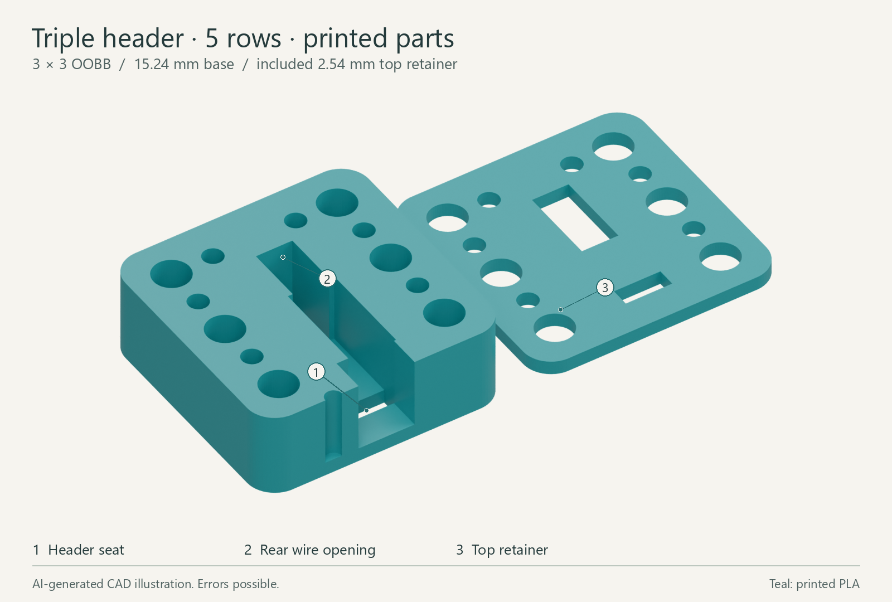
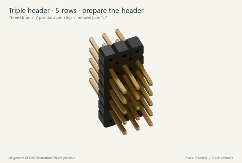
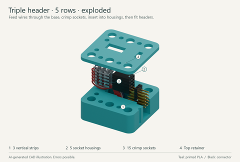
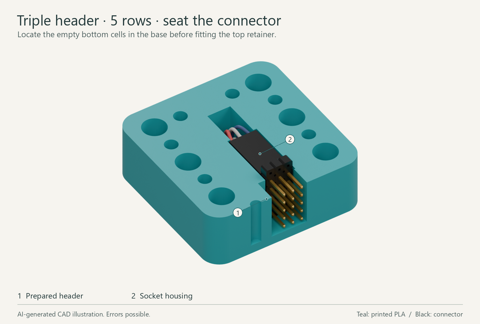
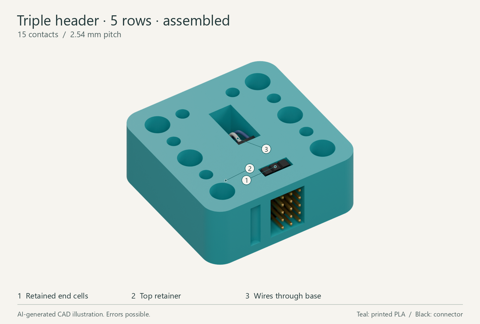

<!-- oobb-presentation:start -->
# Triple header · 5 rows

A 5-row, three-contact-wide connector using three vertical header_long strips with equal pin ends and an included top retainer. The base is 2.54 mm plus 5 × 2.54 mm; the top adds 2.54 mm when fitted.

AI-generated CAD images and instructions. Errors possible.

This is an entirely AI-generated coding project. The source code is largely unreadable by humans, but usable generated files are included. It is published so others can use their own AI tools to understand, modify and regenerate the design.

[](README.md)

[Printable STL](3dpr.stl)

## Details

**Full OOMP ID:** `oobb_part_electronic_wire_basic_plate_3_width_3_height_15_24_depth_triple_pin_header_5_multiple`

[Part folder](./) · [OOBB navigation](../../navigation_oobb/)

| Field | Value |
| --- | --- |
| Depth | 15.24 |
| Height | 3 |
| Multiple | 5 |
| Oobb Name | wire |
| Width | 3 |
| Wire Style | triple_pin_header |
| Wire Type | basic |
| Taxonomy | oobb / part / electronic / wire / basic / plate / 3_width / 3_height / 15_24_depth / triple_pin_header / 5_multiple |

<details>
<summary>Full part details: all working.yaml fields</summary>

```yaml
bip_39_2_word_array:
- west
- unique
bip_39_2_word_no_space: westunique
bip_39_2_word_space: west unique
bip_39_2_word_underscore: west_unique
bip_39_3_word_array:
- west
- unique
- envelope
bip_39_3_word_no_space: westuniqueenvelope
bip_39_3_word_space: west unique envelope
bip_39_3_word_underscore: west_unique_envelope
bip_39_full_array:
- west
- unique
- envelope
- castle
- blouse
- gather
- dream
- caution
- powder
- link
- between
- shiver
bip_39_full_no_space: westuniqueenvelopecastleblousegatherdreamcautionpowderlinkbetweenshiver
bip_39_full_space: west unique envelope castle blouse gather dream caution powder
  link between shiver
bip_39_full_underscore: west_unique_envelope_castle_blouse_gather_dream_caution_powder_link_between_shiver
depth: 15.24
directory: parts/oobb_part_electronic_wire_basic_plate_3_width_3_height_15_24_depth_triple_pin_header_5_multiple
height: 3
id: oobb_part_electronic_wire_basic_plate_3_width_3_height_15_24_depth_triple_pin_header_5_multiple
id_no_class: oobb_part_electronic_wire_basic_plate_3_width_3_height_15_24_depth_triple_pin_header_5_multiple
id_no_size: oobb_part_electronic_wire_basic_plate_3_width_3_height_15_24_depth_triple_pin_header_5_multiple
id_no_type: oobb_part_electronic_wire_basic_plate_3_width_3_height_15_24_depth_triple_pin_header_5_multiple
id_oobb: oobb_part_electronic_wire_basic_plate_3_width_3_height_15_24_depth_triple_pin_header_5_multiple
kwargs:
  depth: 15.24
  filter: ''
  generate_stl: false
  height: 3
  modes:
  - 3dpr
  multiple: 5
  navigation: false
  oobb_name: wire
  oomp_description_extra: 15.24_depth
  oomp_description_main: wire_3_width_3_height
  oomp_mode: project
  oomp_run: false
  overwrite: true
  project_name: oomlout_oobb_electronic_version_5
  typ: fast
  type: C:\gh\oomlout_oobb_electronic_version_5_wire
  width: 3
  wire_style: triple_pin_header
  wire_type: basic
link_github: https://github.com/oomlout/oomlout_oomp_version_1_messy/tree/main/parts/oobb_part_electronic_wire_basic_plate_3_width_3_height_15_24_depth_triple_pin_header_5_multiple
link_main: https://github.com/oomlout/oomlout_oomp_version_1_messy/tree/main/parts/oobb_part_electronic_wire_basic_plate_3_width_3_height_15_24_depth_triple_pin_header_5_multiple
link_redirect: https://github.com/oomlout/oomlout_oomp_version_1_messy/tree/main/parts/oobb_part_electronic_wire_basic_plate_3_width_3_height_15_24_depth_triple_pin_header_5_multiple
md5: f97db12f11c182c0d0a125a9304056e3
md5_10: f97db12f11
md5_10_upper: F97DB12F11
md5_5: f97db
md5_5_upper: F97DB
md5_6: f97db1
md5_6_alpha: 9qg8h
md5_6_alpha_upper: 9QG8H
md5_6_upper: F97DB1
multiple: 5
name: Oobb Part Electronic Wire Basic Plate 3 Width 3 Height 15 24 Depth Triple Pin
  Header 5 Multiple
name_no_class: Oobb Part Electronic Wire Basic Plate 3 Width 3 Height 15 24 Depth
  Triple Pin Header 5 Multiple
name_no_size: Oobb Part Electronic Wire Basic Plate 3 Width 3 Height 15 24 Depth Triple
  Pin Header 5 Multiple
name_no_type: Oobb Part Electronic Wire Basic Plate 3 Width 3 Height 15 24 Depth Triple
  Pin Header 5 Multiple
name_proper: Oobb Part Electronic Wire Basic Plate 3 Width 3 Height 15 24 Depth Triple
  Pin Header 5 Multiple
oobb_details:
  depth: 15.24
  height: 3
  multiple: 5
  oobb_name: wire
  width: 3
  wire_style: triple_pin_header
  wire_type: basic
oobb_name: wire
oomp_key: oomp_oobb_part_electronic_wire_basic_plate_3_width_3_height_15_24_depth_triple_pin_header_5_multiple
part_category: wire
part_style: triple_pin_header
part_type: basic
project_name: C:\gh\oomlout_oobb_electronic_version_5
taxonomy_1: oobb
taxonomy_10: triple_pin_header
taxonomy_10_capital: Triple Pin Header
taxonomy_10_first_letter: t
taxonomy_10_first_letter_upper: T
taxonomy_10_length_1: t
taxonomy_10_length_2: tr
taxonomy_10_length_3: tri
taxonomy_10_length_4: trip
taxonomy_10_length_5: tripl
taxonomy_10_upper: TRIPLE_PIN_HEADER
taxonomy_10_upper_length_1: T
taxonomy_10_upper_length_2: TR
taxonomy_10_upper_length_3: TRI
taxonomy_10_upper_length_4: TRIP
taxonomy_10_upper_length_5: TRIPL
taxonomy_11: 5_multiple
taxonomy_11_capital: 5 Multiple
taxonomy_11_first_letter: '5'
taxonomy_11_first_letter_upper: '5'
taxonomy_11_length_1: '5'
taxonomy_11_length_2: '5_'
taxonomy_11_length_3: 5_m
taxonomy_11_length_4: 5_mu
taxonomy_11_length_5: 5_mul
taxonomy_11_upper: 5_MULTIPLE
taxonomy_11_upper_length_1: '5'
taxonomy_11_upper_length_2: '5_'
taxonomy_11_upper_length_3: 5_M
taxonomy_11_upper_length_4: 5_MU
taxonomy_11_upper_length_5: 5_MUL
taxonomy_12: ''
taxonomy_13: ''
taxonomy_14: ''
taxonomy_15: ''
taxonomy_1_capital: Oobb
taxonomy_1_first_letter: o
taxonomy_1_first_letter_upper: O
taxonomy_1_length_1: o
taxonomy_1_length_2: oo
taxonomy_1_length_3: oob
taxonomy_1_length_4: oobb
taxonomy_1_length_5: oobb
taxonomy_1_upper: OOBB
taxonomy_1_upper_length_1: O
taxonomy_1_upper_length_2: OO
taxonomy_1_upper_length_3: OOB
taxonomy_1_upper_length_4: OOBB
taxonomy_1_upper_length_5: OOBB
taxonomy_2: part
taxonomy_2_capital: Part
taxonomy_2_first_letter: p
taxonomy_2_first_letter_upper: P
taxonomy_2_length_1: p
taxonomy_2_length_2: pa
taxonomy_2_length_3: par
taxonomy_2_length_4: part
taxonomy_2_length_5: part
taxonomy_2_upper: PART
taxonomy_2_upper_length_1: P
taxonomy_2_upper_length_2: PA
taxonomy_2_upper_length_3: PAR
taxonomy_2_upper_length_4: PART
taxonomy_2_upper_length_5: PART
taxonomy_3: electronic
taxonomy_3_capital: Electronic
taxonomy_3_first_letter: e
taxonomy_3_first_letter_upper: E
taxonomy_3_length_1: e
taxonomy_3_length_2: el
taxonomy_3_length_3: ele
taxonomy_3_length_4: elec
taxonomy_3_length_5: elect
taxonomy_3_upper: ELECTRONIC
taxonomy_3_upper_length_1: E
taxonomy_3_upper_length_2: EL
taxonomy_3_upper_length_3: ELE
taxonomy_3_upper_length_4: ELEC
taxonomy_3_upper_length_5: ELECT
taxonomy_4: wire
taxonomy_4_capital: Wire
taxonomy_4_first_letter: w
taxonomy_4_first_letter_upper: W
taxonomy_4_length_1: w
taxonomy_4_length_2: wi
taxonomy_4_length_3: wir
taxonomy_4_length_4: wire
taxonomy_4_length_5: wire
taxonomy_4_upper: WIRE
taxonomy_4_upper_length_1: W
taxonomy_4_upper_length_2: WI
taxonomy_4_upper_length_3: WIR
taxonomy_4_upper_length_4: WIRE
taxonomy_4_upper_length_5: WIRE
taxonomy_5: basic
taxonomy_5_capital: Basic
taxonomy_5_first_letter: b
taxonomy_5_first_letter_upper: B
taxonomy_5_length_1: b
taxonomy_5_length_2: ba
taxonomy_5_length_3: bas
taxonomy_5_length_4: basi
taxonomy_5_length_5: basic
taxonomy_5_upper: BASIC
taxonomy_5_upper_length_1: B
taxonomy_5_upper_length_2: BA
taxonomy_5_upper_length_3: BAS
taxonomy_5_upper_length_4: BASI
taxonomy_5_upper_length_5: BASIC
taxonomy_6: plate
taxonomy_6_capital: Plate
taxonomy_6_first_letter: p
taxonomy_6_first_letter_upper: P
taxonomy_6_length_1: p
taxonomy_6_length_2: pl
taxonomy_6_length_3: pla
taxonomy_6_length_4: plat
taxonomy_6_length_5: plate
taxonomy_6_upper: PLATE
taxonomy_6_upper_length_1: P
taxonomy_6_upper_length_2: PL
taxonomy_6_upper_length_3: PLA
taxonomy_6_upper_length_4: PLAT
taxonomy_6_upper_length_5: PLATE
taxonomy_7: 3_width
taxonomy_7_capital: 3 Width
taxonomy_7_first_letter: '3'
taxonomy_7_first_letter_upper: '3'
taxonomy_7_length_1: '3'
taxonomy_7_length_2: '3_'
taxonomy_7_length_3: 3_w
taxonomy_7_length_4: 3_wi
taxonomy_7_length_5: 3_wid
taxonomy_7_upper: 3_WIDTH
taxonomy_7_upper_length_1: '3'
taxonomy_7_upper_length_2: '3_'
taxonomy_7_upper_length_3: 3_W
taxonomy_7_upper_length_4: 3_WI
taxonomy_7_upper_length_5: 3_WID
taxonomy_8: 3_height
taxonomy_8_capital: 3 Height
taxonomy_8_first_letter: '3'
taxonomy_8_first_letter_upper: '3'
taxonomy_8_length_1: '3'
taxonomy_8_length_2: '3_'
taxonomy_8_length_3: 3_h
taxonomy_8_length_4: 3_he
taxonomy_8_length_5: 3_hei
taxonomy_8_upper: 3_HEIGHT
taxonomy_8_upper_length_1: '3'
taxonomy_8_upper_length_2: '3_'
taxonomy_8_upper_length_3: 3_H
taxonomy_8_upper_length_4: 3_HE
taxonomy_8_upper_length_5: 3_HEI
taxonomy_9: 15_24_depth
taxonomy_9_capital: 15.24 Depth
taxonomy_9_first_letter: '1'
taxonomy_9_first_letter_upper: '1'
taxonomy_9_length_1: '1'
taxonomy_9_length_2: '15'
taxonomy_9_length_3: '15_'
taxonomy_9_length_4: '15_2'
taxonomy_9_length_5: '15_24'
taxonomy_9_upper: 15_24_DEPTH
taxonomy_9_upper_length_1: '1'
taxonomy_9_upper_length_2: '15'
taxonomy_9_upper_length_3: '15_'
taxonomy_9_upper_length_4: '15_2'
taxonomy_9_upper_length_5: '15_24'
width: 3
```

</details>



## Parts


Hardware for one connector. Stock and prepared headers are the same items before and after modification.

| Hardware | Quantity | State |
| --- | ---: | --- |
| [7-position header_long section (equal ends)](https://github.com/oomlout/oomp_electronic_version_5/tree/main/parts/electronic_connector_header_long_2_54_mm_pitch_through_hole_7_pin) | 3 | starting hardware |
| [Prepared vertical strip](https://github.com/oomlout/oomp_electronic_version_5/tree/main/parts/electronic_connector_header_oobb_2_54_mm_pitch_vertical_5_row_7_position_5_contact) | 3 | after modification |
| [3-way socket housing](https://github.com/oomlout/oomp_electronic_version_5/tree/main/parts/electronic_connector_header_2_54_mm_pitch_housing_3_pin_black_harwin_m20_1060300) | 5 | starting hardware |
| [Female crimp socket, 22–30 AWG](https://github.com/oomlout/oomp_electronic_version_5/tree/main/parts/electronic_connector_header_2_54_mm_pitch_crimp_1_pin_socket_22_to_30_awg_tin_harwin_m20_1180046) | 15 | starting hardware |
| Wires, sized for the crimp contacts | 15 | Cut to suit |

Header stock: [HOAUC 1625-1140CNG0S150001 / LCSC C343639](https://www.lcsc.com/product-detail/C343639.html) — a 40-position strip to cut to length. [Manufacturer drawing](https://atta.szlcsc.com/upload/public/pdf/source/20260917/9F655738B2D4F4FC500A9931BECCBD77.pdf).

## Assembly

[Browser guide](https://oomlout.github.io/oomlout_oobb_electronic_version_5/parts/oobb_part_electronic_wire_basic_plate_3_width_3_height_15_24_depth_triple_pin_header_5_multiple/assembly/assembly_instructions.html) · [PDF](https://oomlout.github.io/oomlout_oobb_electronic_version_5/parts/oobb_part_electronic_wire_basic_plate_3_width_3_height_15_24_depth_triple_pin_header_5_multiple/assembly/assembly_instructions.pdf) · [Download offline HTML](https://github.com/oomlout/oomlout_oobb_electronic_version_5/raw/refs/heads/main/parts/oobb_part_electronic_wire_basic_plate_3_width_3_height_15_24_depth_triple_pin_header_5_multiple/assembly/assembly_instructions.html)

1. Cut three 7-position sections of header_long (6.25 mm exposed at both ends). Push out pins 1, 7 from each strip; keep both end cells intact. Stand the strips vertically, counting from the bottom.

[](basic_wire_keyed.png)

2. Pass 15 wires up through the rear opening before crimping. Crimp one socket per wire and insert the sockets into the backs of the housings until latched.

[](basic_wire_exploded.png)

3. Place the three vertical strips into the bottom beam window, with one set of pin ends facing the keyed front opening. Mate one three-way housing with each active row.

[](basic_wire_seating.png)

4. Fit the included top retainer over the three empty top cells. It is printed beside the base in the same part file. Keep the rear wire opening clear.

[](basic_wire_assembled.png)

The stock and prepared header rows describe the same item before and after modification. Use 15 mm overall header_long stock (6.25 mm exposed on each side of a 2.5 mm insulator); LCSC C343639 is a 40-position strip cut to the required lengths. Wire colours identify conductors, not a pinout. Housing and uncrimped socket geometry use nominal Harwin M20 references; wire bends are illustrative.
<!-- oobb-presentation:end -->
