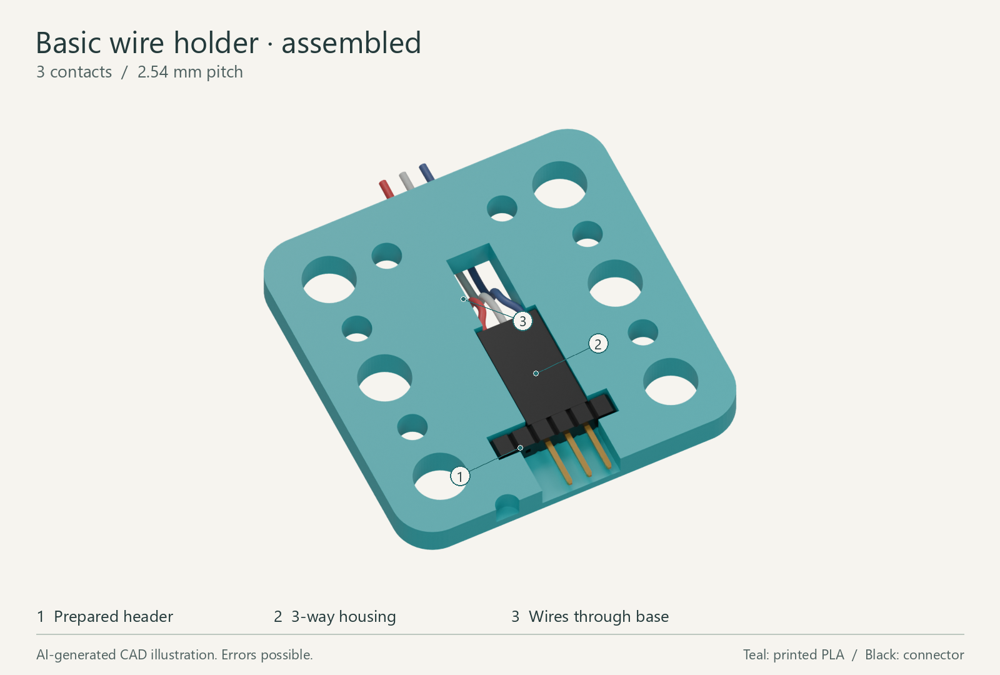
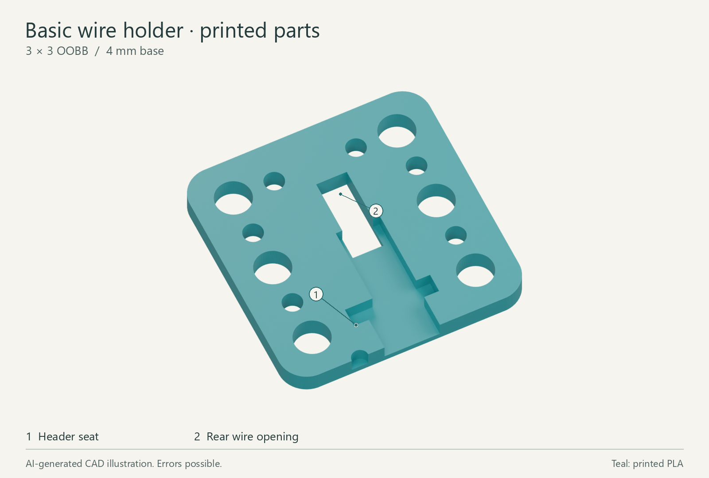
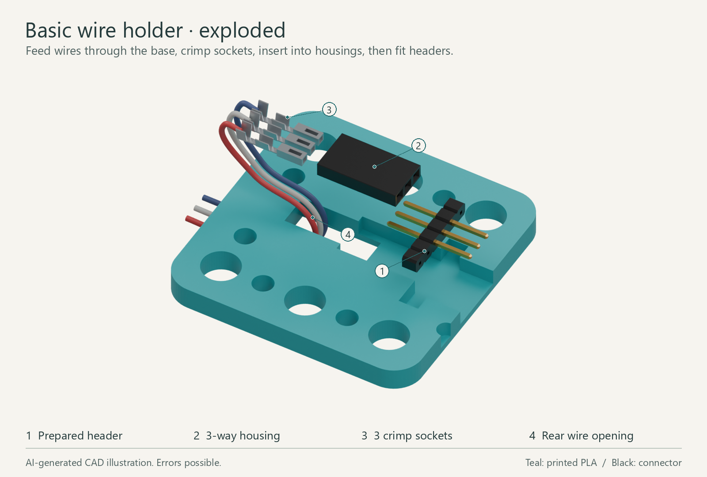
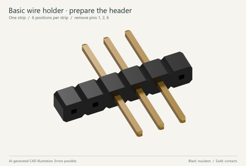
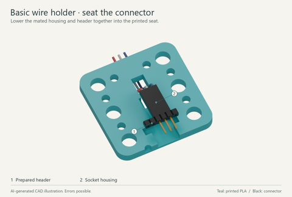
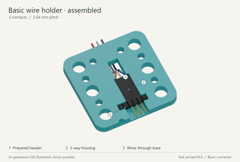

<!-- oobb-presentation:start -->
# Basic wire holder

A printed basic wire holder converts a 6-position header_long with equal pin ends into a 3-contact connector. Empty plastic cells locate the header in the plate.

AI-generated CAD images and instructions. Errors possible.

This is an entirely AI-generated coding project. The source code is largely unreadable by humans, but usable generated files are included. It is published so others can use their own AI tools to understand, modify and regenerate the design.

[](README.md)

[Printable STL](3dpr.stl)

## Details

**Full OOMP ID:** `oobb_part_electronic_wire_basic_plate_3_width_3_height_4_depth`

[Part folder](./) · [OOBB navigation](../../navigation_oobb/)

| Field | Value |
| --- | --- |
| Depth | 4 |
| Height | 3 |
| Oobb Name | wire |
| Width | 3 |
| Wire Style |  |
| Wire Type | basic |
| Taxonomy | oobb / part / electronic / wire / basic / plate / 3_width / 3_height / 4_depth |

<details>
<summary>Full part details: all working.yaml fields</summary>

```yaml
bip_39_2_word_array:
- cube
- magic
bip_39_2_word_no_space: cubemagic
bip_39_2_word_space: cube magic
bip_39_2_word_underscore: cube_magic
bip_39_3_word_array:
- cube
- magic
- merge
bip_39_3_word_no_space: cubemagicmerge
bip_39_3_word_space: cube magic merge
bip_39_3_word_underscore: cube_magic_merge
bip_39_full_array:
- cube
- magic
- merge
- clump
- shield
- enough
- priority
- october
- patrol
- dance
- grace
- hidden
bip_39_full_no_space: cubemagicmergeclumpshieldenoughpriorityoctoberpatroldancegracehidden
bip_39_full_space: cube magic merge clump shield enough priority october patrol dance
  grace hidden
bip_39_full_underscore: cube_magic_merge_clump_shield_enough_priority_october_patrol_dance_grace_hidden
depth: 4
directory: parts/oobb_part_electronic_wire_basic_plate_3_width_3_height_4_depth
height: 3
id: oobb_part_electronic_wire_basic_plate_3_width_3_height_4_depth
id_no_class: oobb_part_electronic_wire_basic_plate_3_width_3_height_4_depth
id_no_size: oobb_part_electronic_wire_basic_plate_3_width_3_height_4_depth
id_no_type: oobb_part_electronic_wire_basic_plate_3_width_3_height_4_depth
id_oobb: oobb_part_electronic_wire_basic_plate_3_width_3_height_4_depth
kwargs:
  depth: 4
  filter: ''
  generate_stl: false
  height: 3
  modes:
  - 3dpr
  navigation: false
  oobb_name: wire
  oomp_description_extra: 4_depth
  oomp_description_main: wire_3_width_3_height
  oomp_mode: project
  oomp_run: false
  overwrite: true
  typ: fast
  type: default_wire
  width: 3
  wire_style: ''
  wire_type: basic
link_github: https://github.com/oomlout/oomlout_oomp_version_1_messy/tree/main/parts/oobb_part_electronic_wire_basic_plate_3_width_3_height_4_depth
link_main: https://github.com/oomlout/oomlout_oomp_version_1_messy/tree/main/parts/oobb_part_electronic_wire_basic_plate_3_width_3_height_4_depth
link_redirect: https://github.com/oomlout/oomlout_oomp_version_1_messy/tree/main/parts/oobb_part_electronic_wire_basic_plate_3_width_3_height_4_depth
md5: 3570ba2d962c5a95eabcc8a126e995b5
md5_10: 3570ba2d96
md5_10_upper: 3570BA2D96
md5_5: 3570b
md5_5_upper: 3570B
md5_6: 3570ba
md5_6_alpha: 232d6
md5_6_alpha_upper: 232D6
md5_6_upper: 3570BA
name: Oobb Part Electronic Wire Basic Plate 3 Width 3 Height 4 Depth
name_no_class: Oobb Part Electronic Wire Basic Plate 3 Width 3 Height 4 Depth
name_no_size: Oobb Part Electronic Wire Basic Plate 3 Width 3 Height 4 Depth
name_no_type: Oobb Part Electronic Wire Basic Plate 3 Width 3 Height 4 Depth
name_proper: Oobb Part Electronic Wire Basic Plate 3 Width 3 Height 4 Depth
name_space: oobb part electronic wire basic plate 3 width 3 height 4 depth
name_upper: OOBB PART ELECTRONIC WIRE BASIC PLATE 3 WIDTH 3 HEIGHT 4 DEPTH
oobb_details:
  depth: 4
  height: 3
  oobb_name: wire
  width: 3
  wire_style: ''
  wire_type: basic
oobb_name: wire
oomlout_ai_roboclick_1:
  actions:
  - command: text_jinja_template
    convert_to_pdf: false
    convert_to_png: false
    dict_data:
      depth: 4
      directory: parts\oobb_part_electronic_wire_basic_plate_3_width_3_height_4_depth
      height: 3
      name: oobb_part_electronic_wire_basic_plate_3_width_3_height_4_depth
      name_proper: Oobb Part Electronic Wire Basic Plate 3 Width 3 Height 4 Depth
      name_space: oobb part electronic wire basic plate 3 width 3 height 4 depth
      name_upper: OOBB PART ELECTRONIC WIRE BASIC PLATE 3 WIDTH 3 HEIGHT 4 DEPTH
      oobb_details:
        depth: 4
        height: 3
        oobb_name: wire
        width: 3
        wire_style: ''
        wire_type: basic
      part_category: wire
      part_type: basic
      taxonomy_1: oobb
      taxonomy_10: ''
      taxonomy_11: ''
      taxonomy_12: ''
      taxonomy_13: ''
      taxonomy_14: ''
      taxonomy_15: ''
      taxonomy_2: part
      taxonomy_3: electronic
      taxonomy_4: wire
      taxonomy_5: basic
      taxonomy_6: plate
      taxonomy_7: 3_width
      taxonomy_8: 3_height
      taxonomy_9: 4_depth
      url_chat: ''
      width: 3
    dict_data_files: {}
    dict_data_files_exists: {}
    file_output: label_oomp.svg
    file_template: C:\gh\oomlout_oobb_electronic_version_5\source_file\template_jinja\template_jinja_label_oomlout_76_2_mm_50_8_mm\working.svg.j2
    search_and_replace: []
  file_test: label_oomp.pdf
  retries_until_complete: 0
oomp_key: oomp_oobb_part_electronic_wire_basic_plate_3_width_3_height_4_depth
part_category: wire
part_type: basic
project_name: C:\gh\oomlout_oobb_electronic_version_5
taxonomy_1: oobb
taxonomy_10: ''
taxonomy_11: ''
taxonomy_12: ''
taxonomy_13: ''
taxonomy_14: ''
taxonomy_15: ''
taxonomy_1_capital: Oobb
taxonomy_1_first_letter: o
taxonomy_1_first_letter_upper: O
taxonomy_1_length_1: o
taxonomy_1_length_2: oo
taxonomy_1_length_3: oob
taxonomy_1_length_4: oobb
taxonomy_1_length_5: oobb
taxonomy_1_upper: OOBB
taxonomy_1_upper_length_1: O
taxonomy_1_upper_length_2: OO
taxonomy_1_upper_length_3: OOB
taxonomy_1_upper_length_4: OOBB
taxonomy_1_upper_length_5: OOBB
taxonomy_2: part
taxonomy_2_capital: Part
taxonomy_2_first_letter: p
taxonomy_2_first_letter_upper: P
taxonomy_2_length_1: p
taxonomy_2_length_2: pa
taxonomy_2_length_3: par
taxonomy_2_length_4: part
taxonomy_2_length_5: part
taxonomy_2_upper: PART
taxonomy_2_upper_length_1: P
taxonomy_2_upper_length_2: PA
taxonomy_2_upper_length_3: PAR
taxonomy_2_upper_length_4: PART
taxonomy_2_upper_length_5: PART
taxonomy_3: electronic
taxonomy_3_capital: Electronic
taxonomy_3_first_letter: e
taxonomy_3_first_letter_upper: E
taxonomy_3_length_1: e
taxonomy_3_length_2: el
taxonomy_3_length_3: ele
taxonomy_3_length_4: elec
taxonomy_3_length_5: elect
taxonomy_3_upper: ELECTRONIC
taxonomy_3_upper_length_1: E
taxonomy_3_upper_length_2: EL
taxonomy_3_upper_length_3: ELE
taxonomy_3_upper_length_4: ELEC
taxonomy_3_upper_length_5: ELECT
taxonomy_4: wire
taxonomy_4_capital: Wire
taxonomy_4_first_letter: w
taxonomy_4_first_letter_upper: W
taxonomy_4_length_1: w
taxonomy_4_length_2: wi
taxonomy_4_length_3: wir
taxonomy_4_length_4: wire
taxonomy_4_length_5: wire
taxonomy_4_upper: WIRE
taxonomy_4_upper_length_1: W
taxonomy_4_upper_length_2: WI
taxonomy_4_upper_length_3: WIR
taxonomy_4_upper_length_4: WIRE
taxonomy_4_upper_length_5: WIRE
taxonomy_5: basic
taxonomy_5_capital: Basic
taxonomy_5_first_letter: b
taxonomy_5_first_letter_upper: B
taxonomy_5_length_1: b
taxonomy_5_length_2: ba
taxonomy_5_length_3: bas
taxonomy_5_length_4: basi
taxonomy_5_length_5: basic
taxonomy_5_upper: BASIC
taxonomy_5_upper_length_1: B
taxonomy_5_upper_length_2: BA
taxonomy_5_upper_length_3: BAS
taxonomy_5_upper_length_4: BASI
taxonomy_5_upper_length_5: BASIC
taxonomy_6: plate
taxonomy_6_capital: Plate
taxonomy_6_first_letter: p
taxonomy_6_first_letter_upper: P
taxonomy_6_length_1: p
taxonomy_6_length_2: pl
taxonomy_6_length_3: pla
taxonomy_6_length_4: plat
taxonomy_6_length_5: plate
taxonomy_6_upper: PLATE
taxonomy_6_upper_length_1: P
taxonomy_6_upper_length_2: PL
taxonomy_6_upper_length_3: PLA
taxonomy_6_upper_length_4: PLAT
taxonomy_6_upper_length_5: PLATE
taxonomy_7: 3_width
taxonomy_7_capital: 3 Width
taxonomy_7_first_letter: '3'
taxonomy_7_first_letter_upper: '3'
taxonomy_7_length_1: '3'
taxonomy_7_length_2: '3_'
taxonomy_7_length_3: 3_w
taxonomy_7_length_4: 3_wi
taxonomy_7_length_5: 3_wid
taxonomy_7_upper: 3_WIDTH
taxonomy_7_upper_length_1: '3'
taxonomy_7_upper_length_2: '3_'
taxonomy_7_upper_length_3: 3_W
taxonomy_7_upper_length_4: 3_WI
taxonomy_7_upper_length_5: 3_WID
taxonomy_8: 3_height
taxonomy_8_capital: 3 Height
taxonomy_8_first_letter: '3'
taxonomy_8_first_letter_upper: '3'
taxonomy_8_length_1: '3'
taxonomy_8_length_2: '3_'
taxonomy_8_length_3: 3_h
taxonomy_8_length_4: 3_he
taxonomy_8_length_5: 3_hei
taxonomy_8_upper: 3_HEIGHT
taxonomy_8_upper_length_1: '3'
taxonomy_8_upper_length_2: '3_'
taxonomy_8_upper_length_3: 3_H
taxonomy_8_upper_length_4: 3_HE
taxonomy_8_upper_length_5: 3_HEI
taxonomy_9: 4_depth
taxonomy_9_capital: 4 Depth
taxonomy_9_first_letter: '4'
taxonomy_9_first_letter_upper: '4'
taxonomy_9_length_1: '4'
taxonomy_9_length_2: '4_'
taxonomy_9_length_3: 4_d
taxonomy_9_length_4: 4_de
taxonomy_9_length_5: 4_dep
taxonomy_9_upper: 4_DEPTH
taxonomy_9_upper_length_1: '4'
taxonomy_9_upper_length_2: '4_'
taxonomy_9_upper_length_3: 4_D
taxonomy_9_upper_length_4: 4_DE
taxonomy_9_upper_length_5: 4_DEP
url_chat: ''
width: 3
```

</details>



## Parts



Hardware for one connector. Stock and prepared headers are the same items before and after modification.

| Hardware | Quantity | State |
| --- | ---: | --- |
| [6-position header_long section (equal ends)](https://github.com/oomlout/oomp_electronic_version_5/tree/main/parts/electronic_connector_header_long_2_54_mm_pitch_through_hole_6_pin) | 1 | starting hardware |
| [Prepared OOBB header](https://github.com/oomlout/oomp_electronic_version_5/tree/main/parts/electronic_connector_header_oobb_2_54_mm_pitch_basic_6_position_3_contact) | 1 | after modification |
| [3-way socket housing](https://github.com/oomlout/oomp_electronic_version_5/tree/main/parts/electronic_connector_header_2_54_mm_pitch_housing_3_pin_black_harwin_m20_1060300) | 1 | starting hardware |
| [Female crimp socket, 22–30 AWG](https://github.com/oomlout/oomp_electronic_version_5/tree/main/parts/electronic_connector_header_2_54_mm_pitch_crimp_1_pin_socket_22_to_30_awg_tin_harwin_m20_1180046) | 3 | starting hardware |
| Wires, sized for the crimp contacts | 3 | Cut to suit |

Header stock: [HOAUC 1625-1140CNG0S150001 / LCSC C343639](https://www.lcsc.com/product-detail/C343639.html) — a 40-position strip to cut to length. [Manufacturer drawing](https://atta.szlcsc.com/upload/public/pdf/source/20260917/9F655738B2D4F4FC500A9931BECCBD77.pdf).

## Assembly

[Browser guide](https://oomlout.github.io/oomlout_oobb_electronic_version_5/parts/oobb_part_electronic_wire_basic_plate_3_width_3_height_4_depth/assembly/assembly_instructions.html) · [PDF](https://oomlout.github.io/oomlout_oobb_electronic_version_5/parts/oobb_part_electronic_wire_basic_plate_3_width_3_height_4_depth/assembly/assembly_instructions.pdf) · [Download offline HTML](https://github.com/oomlout/oomlout_oobb_electronic_version_5/raw/refs/heads/main/parts/oobb_part_electronic_wire_basic_plate_3_width_3_height_4_depth/assembly/assembly_instructions.html)

1. Cut one 6-position section of header_long (6.25 mm exposed at both ends). Count from the key side (negative X in the model) and push out pins 1, 2, 6; keep the full plastic strip.

[](basic_wire_keyed.png)

2. Pass 3 wires up through the rear opening before crimping. Crimp one socket per wire and insert the sockets into the backs of the housings until latched.

[](basic_wire_exploded.png)

3. Mate the housing with the rear 6.25 mm pin ends, then lower the header and housing into their seats. The equal front ends face the front opening.

[](basic_wire_seating.png)

4. Check that the wires move freely through the rear opening and the contacts remain recessed inside the front edge.

[](basic_wire_assembled.png)

The stock and prepared header rows describe the same item before and after modification. Use 15 mm overall header_long stock (6.25 mm exposed on each side of a 2.5 mm insulator); LCSC C343639 is a 40-position strip cut to the required lengths. Wire colours identify conductors, not a pinout. Housing and uncrimped socket geometry use nominal Harwin M20 references; wire bends are illustrative.
<!-- oobb-presentation:end -->
